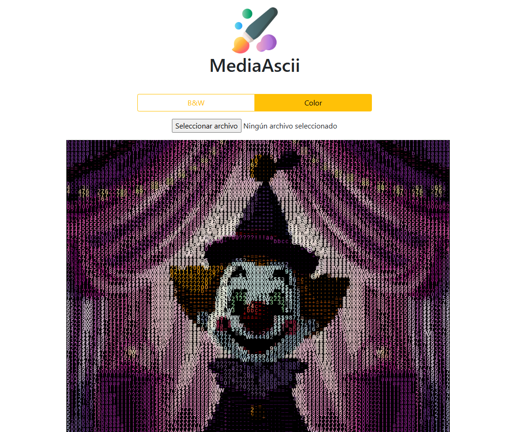

# 🖼️ ascii-img

Convert any image to **ASCII art** directly in your terminal or code!  
Fast, lightweight, and simple — perfect for scripts, tools, or just for fun.

---

## 🚀 What Is This?

**ascii-img** is a utility that converts images (JPG) into ASCII representations.  
Whether you want terminal art, stylized visual output, or just a neat hack — this tool makes it easy.

---

## 🔧 Features

- 🧠 Converts a wide range of images to ASCII art
- 📦 Works with common image formats
- 📤 Outputs clean ASCII to terminal or file
- ⚡ Fast and lightweight
- 📍 Easy to integrate into other projects

---

## 🛠 How It Works

This tool reads the grayscale values of each pixel, then maps them to corresponding ASCII characters based on intensity.  
Darker pixels become dense characters (`@`, `#`), lighter pixels become sparse characters (`.`, ` `), giving an art-like effect in text.

---

## 📦 Installation

1. Clone the repo:

```bash
git clone https://github.com/rennyjr98/ascii-img.git
```

2. Install dependencies:

```bash
npm install
```

## ▶️ Usage

Run the project and upload an image, after processing time you'll get a new image completely created using ASCII characters.


